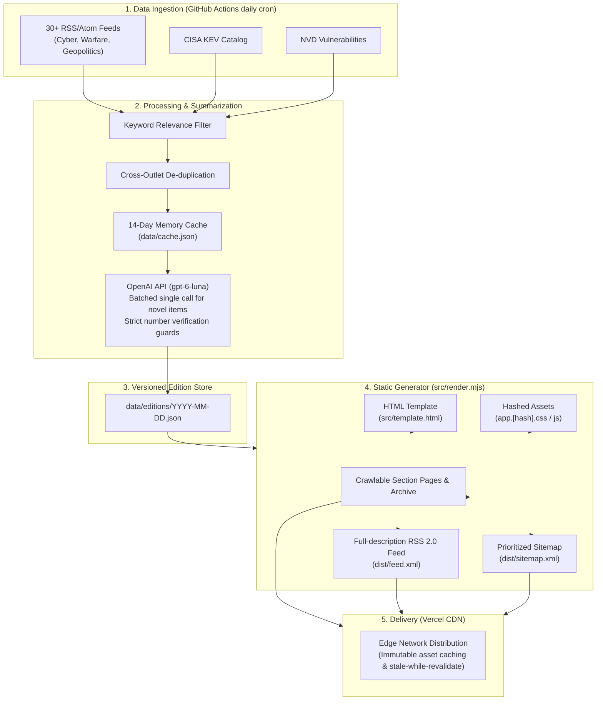

# Outpost


An autonomous daily briefing on **cybersecurity, modern warfare technology, geodata and geopolitics**, built only from open sources. Every headline links to its source; AI is used only to write short summaries and one "learn today" concept per domain.

**Live site:** [outpostdaily.com](https://www.outpostdaily.com)

## Quick Start

Prerequisites: Node.js 20+

```bash
# Clone the repository
git clone https://github.com/kyrillidis/outpostdaily.git
cd outpostdaily

# Install dependencies
npm install

# Build the static site into dist/
npm run build

# Preview locally
npx serve dist
# or: python3 -m http.server 3000 -d dist

# Run unit tests
npm test
```

To fetch fresh source feeds and compile a new edition locally:
```bash
# AI summaries require OPENAI_API_KEY; without it, feed snippets are used automatically
OPENAI_API_KEY="sk-..." npm run daily
```

## How it works



```
GitHub Actions (daily cron)
  └─ npm test        invariants: SEO, accessibility, CSP, image hygiene, size budgets, no secrets
  └─ npm run fetch   RSS/Atom feeds + CISA KEV + NVD  ->  data/editions/<date>.json   (+ ONE small AI call)
  └─ npm run build   data/editions/*.json + src/template.html  ->  dist/   (no network, no AI)
  └─ git push        commits data/
  └─ vercel deploy   publishes dist/ (needs the VERCEL_TOKEN secret)
```

The site build is pure, so an outage at a feed or at the AI provider can never break a deploy. If the AI call fails or no key is set, the edition still publishes using each feed's own snippet.

## Breaking watch (every 5 minutes)

`.github/workflows/breaking.yml` runs `src/breaking.mjs`, which reads the X accounts in `config/breaking.json` through [twitterapi.io](https://twitterapi.io) (one search call per group, only posts newer than the last run), fast security RSS feeds, the ransomware.live victim feed and public forum listings. New items go to `data/breaking.json` (72-hour window) and appear on `/breaking/` and in a strip on the home page. The workflow commits and deploys only when something new arrived. Forum and leak-site entries are shown as **Unverified** claims: headline and link only, no leaked data.

Required GitHub Actions secret: `TWITTERAPI_KEY`. Local run: `TWITTERAPI_KEY=... node src/breaking.mjs`. Article thumbnails on stories are downloaded and resized at fetch time into `public/img/news/` (self-hosted, credited to the outlet).

## Keeping AI usage minimal

- Feeds, ranking, de-duplication across outlets, and the CVE table are plain code — no AI.
- One batched call per day, only for items not already summarised (`data/cache.json`, 14-day memory). No new items → no call.
- Input is the headline plus 260 characters per item (~26 items); output is capped at 6,000 tokens at low reasoning effort. A typical run uses about 4,500 tokens, well under a cent per day.
- Default model is `gpt-6-luna`. Change it with the repository variable `OPENAI_MODEL` (Settings → Secrets and variables → Actions → Variables) — no code change.

## Accuracy guards

- Links, dates and sources come from the feeds; the model never writes a URL.
- The model is told to use only the supplied headline and snippet. Any number in its output that is not in the source text causes that AI text to be discarded in favour of the snippet.
- Stories covered by several outlets are merged and show every outlet.
- Feeds that fail are listed on the **Today & Learn** page instead of being hidden.

## Design and content

The look is documented in [`DESIGN.md`](DESIGN.md) and the product rules in [`PRODUCT.md`](PRODUCT.md).

| Where | What |
| --- | --- |
| `src/assets/app.css`, `app.js` | the whole stylesheet and the small, optional client script (hashed into `dist/assets/` at build) |
| `src/template.html` | the page shell; `src/render.mjs` fills it and writes every route, the sitemap and the RSS feed |
| `config/images.json` + `public/img/` | credited photographs shown behind the logo and header, one per page (public domain, CC0 or CC BY only) |
| `config/glossary.json` | plain-language definitions; also feeds each page's "Key terms" panel |
| `src/pages/*.html` | About, Methodology, Privacy and the Glossary introduction |

## Adding sources

Edit `config/sources.json` (feeds, grouped by `cyber` / `warfare` / `geo`; general outlets get `"filter": true` so only items matching the `relevance` pattern are kept) or `config/toolbox.json` (OSINT tool links shown on the Toolbox page). The toolbox is seeded with well-known OSINT resources; to mirror the [OSINT4All](https://start.me/p/L1rEYQ/osint4all) start.me page, export it from start.me and add its links to `toolbox.json`.

## License

MIT
